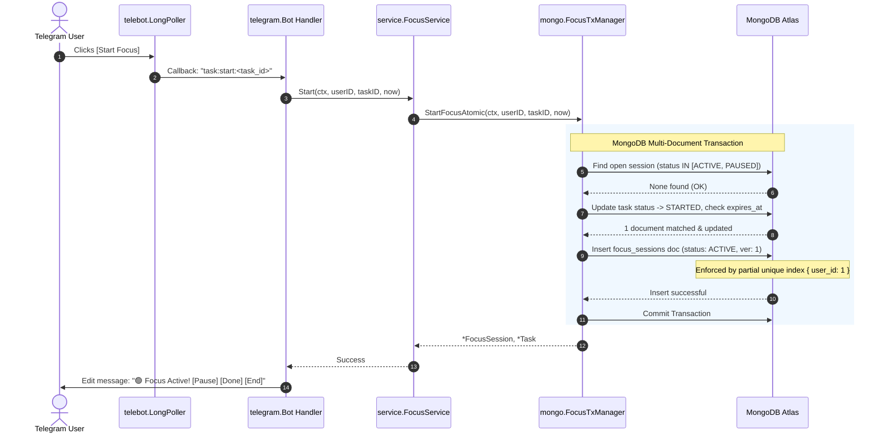

# System Architecture & Technical Specifications

This document outlines the internal architecture, data durability guarantees, state machines, concurrency protections, and AI integration for `ttaskam`.

---

## 1. Package Structure & Responsibilities

```
ttaskam/
├── cmd/
│   └── bot/
│       └── main.go                 # Entry point, dependency injection, graceful shutdown
├── internal/
│   ├── domain/
│   │   ├── task.go                 # Task entity, lifecycle states, 72h decay rules
│   │   ├── session.go              # FocusSession entity, versioning, elapsed duration
│   │   ├── errors.go               # Sentinel domain errors (ErrFocusTunnelActive, etc.)
│   │   ├── repository.go           # Repository & transaction manager contracts
│   │   └── ai.go                   # AI intent types and interpreter interfaces
│   ├── service/
│   │   ├── task_service.go         # Task capture, micro-start validation, AI guardrails
│   │   └── focus_service.go        # Focus orchestration (Start, Pause, Resume, End, Done)
│   └── adapter/
│       ├── mongo/
│       │   ├── indexes.go          # Database index specs (partial unique, TTL)
│       │   ├── task_repo.go        # MongoDB task queries & transactional idempotency
│       │   ├── session_repo.go     # MongoDB focus session persistence
│       │   └── focus_tx_manager.go # Multi-document atomic transactions (Start, Complete)
│       ├── telegram/
│       │   ├── bot.go              # Telebot handlers, routing, session guard
│       │   ├── keyboards.go        # Inline button builders with versioned callbacks
│       │   └── config.go           # Configuration & .env file loader
│       ├── llm/
│       │   └── client.go           # REST client for OpenAI/Gemini chat completions
│       └── memory/
│           └── memory_repo.go      # In-memory mock with failure injection for unit tests
```

---

## 2. Request & Execution Path

The diagram below traces an incoming Telegram update through long polling, handler validation, application services, and MongoDB Atlas:



---

## 3. State Durability & Memory Boundaries

| State Layer | Location | Survives Restart? | Details |
| :--- | :--- | :---: | :--- |
| **Tasks** | MongoDB Atlas (`tasks` collection) | **Yes** | Full lifecycle: title, micro-start, status, `created_at`, `expires_at`, `started_at`, `completed_at`. |
| **Focus Sessions** | MongoDB Atlas (`focus_sessions` collection) | **Yes** | Status, version, start/pause/end timestamps, accumulated active seconds, optional exit reason. |
| **Task Idempotency** | MongoDB Atlas (`task_idempotency` collection) | **Yes** | Unique `{ user_id, idempotency_key }` with 24-hour TTL. Prevents duplicate task creation on network retries. |
| **Pending Micro-Start** | In-Memory Go map (`b.pendingStep` in `Bot`) | **No** | Ephemeral pointer tracking if a user is currently typing a custom micro-start. Cleared on process restart. |

> [!NOTE]
> If the bot process crashes while a user is prompted to type a micro-start, the draft task remains safely in MongoDB (`CREATED` status with empty `MicroStart`). Upon restart, the user can find it in `/tasks` and set the step.

---

## 4. Invariants, Code Locations & Guarantees

### A. One-Open-Session Rule
- **Code**: [internal/adapter/mongo/indexes.go](../internal/adapter/mongo/indexes.go)
  ```javascript
  db.focus_sessions.createIndex(
    { user_id: 1 },
    { unique: true, partialFilterExpression: { status: { $in: ["ACTIVE", "PAUSED"] } } }
  )
  ```
- **Guarantee**: Even under high concurrency (e.g. rapid double-tap or requests from multiple devices), MongoDB's storage engine enforces that only one active or paused session can exist for a user.
- **Limit**: Does not prevent user from starting a task if their previous session was already marked `ENDED` or `COMPLETED`.

### B. Atomic Start and Done
- **Code**: [internal/adapter/mongo/focus_tx_manager.go](../internal/adapter/mongo/focus_tx_manager.go)
- **Guarantee**:
  - `StartFocusAtomic`: Task transition to `STARTED` and session insertion occur inside a MongoDB transaction (`client.UseSession`). If either fails, the transaction aborts and zero partial records are committed.
  - `CompleteFocusAtomic`: Session completion (`COMPLETED`) and task completion (`COMPLETED`) occur in the same transaction. Both records are verified before commit.

### C. 72-Hour Task Decay Rule
- **Code**: [internal/domain/task.go](../internal/domain/task.go)
  ```go
  func (t *Task) IsExpired(now time.Time) bool {
      if t.Status != TaskStatusCreated {
          return false // Started tasks never expire
      }
      return !now.Before(t.ExpiresAt) // now >= expires_at
  }
  ```
- **Guarantee**: Applied strictly to never-started tasks. Tasks in `STARTED` status never decay.
- **Double-Enforcement**: Evaluated dynamically on any action or query in [task_service.go](../internal/service/task_service.go), plus an indexed TTL cleanup mechanism in MongoDB.

### D. Duplicate Task Protection
- **Code**: [internal/adapter/mongo/task_repo.go](../internal/adapter/mongo/task_repo.go)
- **Guarantee**: Task creation and idempotency recording are coupled within a transaction. A replay of the same Telegram message ID returns the existing task without creating duplicates, and no orphaned idempotency record can exist without its task.

### E. Stale Button & Versioned Callbacks
- **Code**: [internal/adapter/telegram/keyboards.go](../internal/adapter/telegram/keyboards.go) and [internal/adapter/mongo/focus_tx_manager.go](../internal/adapter/mongo/focus_tx_manager.go)
- **Guarantee**: Buttons embed `focus:<action>:<session_id>:<version>`. Handlers verify that the target session matches `session_id` and the current `version`. Old buttons from earlier or already-transitioned sessions return an immediate alert (*"Session state has changed or button is stale"*) without modifying state.

---

## 5. AI Integration Status

### Current Implementation
- **Adapter**: [internal/adapter/llm/client.go](../internal/adapter/llm/client.go) implements an OpenAI-compatible REST client (`POST /chat/completions`) with strict JSON schema response parsing.
- **Wiring**: In [cmd/bot/main.go](../cmd/bot/main.go), the bot checks if `LLM_API_KEY` is present.
  - If **present**: Initializes the client and enables AI interpretation.
  - If **absent**: Automatically logs `[INFO] No LLM_API_KEY detected. Running in pure deterministic manual mode (AI disabled)`.
- **Validation**: Handled in [internal/service/task_service.go](../internal/service/task_service.go) (`ProcessUserMessage` and `applyAIGuardrails`).

### Status Summary
- **Code**: Fully implemented and wired.
- **Unit & Mock Tests**: **Passed** ([internal/service/ai_eval_test.go](../internal/service/ai_eval_test.go)).
- **Live Model Execution**: **Pending `LLM_API_KEY` configuration**. Currently runs in manual fallback mode in the live running process.

---

## 6. Testing Guide

Do not treat passing unit tests as proof of live external connectivity. Each layer is tested independently:

### 1. Unit & Domain Tests (Offline, Fast)
Tests domain invariants, state transitions, versioning, mock AI evaluation, and failure injection without requiring MongoDB or network access:
```powershell
go test -v ./internal/domain ./internal/service ./internal/adapter/telegram
```

### 2. Live MongoDB Atlas Integration Test
Connects to live MongoDB Atlas, creates a temporary database (`test_ttaskam_<timestamp>`), tests atomic multi-document transactions, verifies partial unique indexes, and cleans up:
```powershell
$env:MONGO_URI = "mongodb+srv://<user>:<password>@cluster0.mongodb.net/?retryWrites=true&w=majority"
go test -v -run TestMongo_Integration ./internal/adapter/mongo
```

### 3. Live Model Evaluation (Requires LLM API Key)
Executes a multi-turn scorecard testing prompt classification, Persian/English handling, and latency against the live LLM provider:
```powershell
$env:LLM_API_KEY = "your_actual_key"
$env:LLM_BASE_URL = "https://api.openai.com/v1" # or Gemini compatibility URL
$env:LLM_MODEL = "gpt-4o-mini"
go test -v -run TestLiveLLM_Evaluation ./internal/adapter/llm
```

### 4. Interactive Graphify Code Map
To inspect the structural code graph, dependency hubs, and community clusters:
- **Visual Graph:** [graphify-out/graph.html](../graphify-out/graph.html)
- **Graph Report:** [graphify-out/GRAPH_REPORT.md](../graphify-out/GRAPH_REPORT.md)
